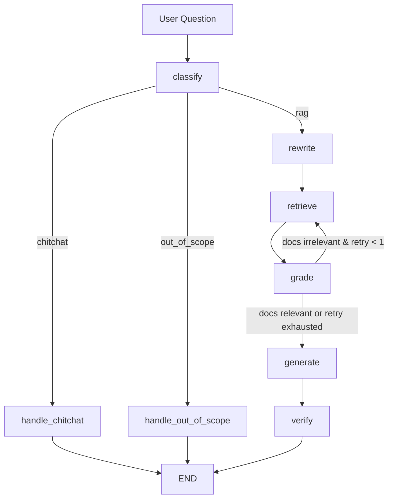

# DarGlobal Real Estate Scraper & RAG Chatbot

Technical assignment: Scrape public property data from DarGlobal (`darglobal.co.uk`), then build a grounded Retrieval-Augmented Generation (RAG) chatbot over the collected data.

## Stack

| Layer | Technology |
|---|---|
| Scraping | `requests` / `httpx`, `BeautifulSoup` / `lxml` |
| Embeddings | Local & free — `fastembed` (`BAAI/bge-small-en-v1.5`, 384-dim) |
| Vector Store | `ChromaDB` (persistent, cosine HNSW) |
| Keyword Search | `rank-bm25` (BM25Okapi) |
| Retrieval Fusion | Reciprocal Rank Fusion (vector + BM25) |
| LLM | OpenRouter free models via OpenAI-compatible API |
| Graph Orchestration | `LangGraph` StateGraph |
| API | `FastAPI` |
| UI | `Streamlit` |

## Project Structure

```text
.
├── scraper/
│   ├── __init__.py
│   ├── config.py          # Frozen dataclass loading .env
│   ├── http_client.py     # Polite HTTP client (robots, delays, cache)
│   ├── robots.py          # robots.txt parser with caching
│   ├── dar_global.py      # DarGlobal site scraper
│   └── run_scrape.py      # Scraper runner
├── data/
│   ├── raw/               # Raw JSON + HTTP cache
│   │   └── cache/
│   ├── processed/         # combined.json
│   └── chroma/            # ChromaDB persistent storage
├── rag/
│   ├── __init__.py
│   ├── ingest.py          # Chunk, embed, store in ChromaDB
│   ├── retriever.py       # Hybrid vector+BM25 retrieval (RRF)
│   ├── graph.py           # LangGraph workflow (classify→retrieve→generate→verify)
│   ├── llm.py             # OpenRouter client wrapper
│   └── prompts.py         # All prompt templates
├── api/
│   ├── __init__.py
│   ├── main.py            # FastAPI app (POST /chat, GET /health, POST /ingest)
│   └── schemas.py         # Pydantic request/response models
├── ui/
│   └── app.py             # Streamlit chat interface
├── tests/
│   ├── __init__.py
│   ├── test_http_client.py
│   ├── test_dar_global.py
│   ├── test_retriever.py
│   ├── test_graph.py
│   └── test_api.py
├── requirements.txt
├── .env.example
└── README.md
```

## Setup

### 1. Clone & install

```bash
git clone <repo-url>
cd DarGlobal
python -m venv .venv
# Windows:
.venv\Scripts\activate
# macOS/Linux:
# source .venv/bin/activate
pip install -r requirements.txt
```

### 2. Configure `.env`

```bash
cp .env.example .env
# Edit .env and set your OPENROUTER_API_KEY
```

For temporary Groq testing, put your Groq API key in the separate `.env.groq`
file and select it before starting the API. This leaves `.env` configured for
OpenRouter so you can switch back for submission by unsetting `LLM_ENV_FILE`.

```powershell
$env:LLM_ENV_FILE = ".env.groq"
uvicorn api.main:app --reload --port 8000
# Return to OpenRouter in this terminal:
Remove-Item Env:LLM_ENV_FILE
```

Set `GROQ_MODEL` in `.env.groq` to any model currently available to your Groq
account. The provided value is Groq's `openai/gpt-oss-20b` model.

| Variable | Required | Default | Description |
|---|---|---|---|
| `OPENROUTER_API_KEY` | ✅ | — | Your OpenRouter API key |
| `OPENROUTER_MODEL` | | `google/gemini-2.0-flash-lite:free` | LLM model (must support OpenAI chat API) |
| `LLM_ENV_FILE` | | — | Optional provider-specific env file, such as `.env.groq` for testing |
| `LLM_PROVIDER` | | `openrouter` | Provider selected by the loaded environment: `openrouter` or `groq` |
| `GROQ_API_KEY` | For Groq | — | Groq API key |
| `GROQ_MODEL` | For Groq | `openai/gpt-oss-20b` | Groq model ID |
| `USER_AGENT_EMAIL` | | `student@example.com` | Contact email in User-Agent |
| `MIN_CRAWL_DELAY` | | `2.0` | Minimum seconds between requests per domain |
| `MAX_PAGES_PER_RUN` | | `150` | Global page cap per scrape run |
| `MAX_PAGES_PER_DOMAIN` | | `100` | Per-domain page cap |
| `API_URL` | | `http://localhost:8000` | FastAPI base URL (for Streamlit UI) |
| `ENABLE_SCRAPE_ENDPOINT` | | `false` | Enable the POST `/scrape` API endpoint |

### 3. Run the pipeline

```bash
# Step 1: Scrape public data (respects robots.txt, rate-limited, cached)
python -m scraper.run_scrape --target darglobal --max-pages 50

# Step 2: Build the vector index
python -c "from rag.ingest import ingest; print(f'Ingested {ingest()} chunks')"

# Step 3: Start the FastAPI backend
uvicorn api.main:app --host 0.0.0.0 --port 8000

# Step 4 (new terminal): Start the Streamlit frontend
streamlit run ui/app.py
```

Open http://localhost:8501 in your browser to chat.

### 4. Run tests

```bash
python -m pytest tests/ -v
```

## Architecture — LangGraph Flow



**Node details:**

| Node | Purpose |
|---|---|
| **classify** | Routes the query: `rag` (real estate), `chitchat` (greeting), or `out_of_scope`. Uses heuristic regex first, falls back to LLM. |
| **rewrite** | Resolves pronouns/follow-ups into standalone queries. Detects `document_type` intent (`property_listing`, `corporate`, `news`). |
| **retrieve** | Hybrid search: dense vectors (ChromaDB + fastembed) **+** sparse BM25, fused via Reciprocal Rank Fusion (k=60). Auto-retries without filter if property query returns < 3 docs. |
| **grade** | Keyword overlap check. If docs are irrelevant and no retry yet, broadens the query and re-retrieves once. |
| **generate** | LLM generates an answer strictly from retrieved context. Cites source URLs; preserves original currencies (AED, GBP, EUR). |
| **verify** | Lightweight groundedness check: extracts numbers from the answer and verifies they appear in the context. Falls back to safe answer on failure. |

## API Endpoints

| Method | Path | Description |
|---|---|---|
| `GET` | `/health` | Returns `{"status": "ok", "model": "..."}` |
| `POST` | `/chat` | Accepts `{question, history?}`, returns `{answer, citations, route, retrieved_docs}` |
| `POST` | `/ingest` | Rebuilds the ChromaDB vector index from `data/raw/darglobal.json` |
| `POST` | `/scrape` | Runs the scraping pipeline (**disabled by default**; set `ENABLE_SCRAPE_ENDPOINT=true`) |

Interactive docs: http://localhost:8000/docs

## Scraping Ethics & Guardrails

This project prioritises ethical and responsible web scraping:

- **robots.txt compliance**: Every URL is checked against the site's `robots.txt` before fetching. Disallowed paths are skipped and logged.
- **Rate limiting**: Enforces `max(robots Crawl-delay, 2 seconds)` **plus random jitter** (0.5–1.5 s) between requests per domain. Never floods a server.
- **Crawl caps**: Global cap of 150 pages per run and 100 per domain by default. Only a limited, representative sample is collected.
- **Caching**: Raw HTTP responses are cached locally (SHA-256 URL hash). Re-runs serve from cache—no unnecessary repeat traffic.
- **Polite User-Agent**: Identifies as `AssignmentResearchBot/1.0 (contact: <email>)` so site operators can reach out.
- **No login / no bypass**: The scraper never logs in, never bypasses CAPTCHAs, paywalls, or anti-bot measures. It stops on 403 or challenge pages.
- **Retry-After honoured**: On HTTP 429, the scraper respects the `Retry-After` header with exponential backoff (max 3 retries).
- **Public data only**: Only publicly visible pages are scraped—no authenticated endpoints, no private APIs.

## Known Limitations

1. **WAF-blocked content**: DarGlobal (`darglobal.co.uk`) serves an Incapsula WAF challenge page to automated requests. Cached responses or browser rendering are used to extract structured data.

2. **Free model limitations**: OpenRouter free models have strict rate limits and may produce lower-quality answers than paid models. Switch `OPENROUTER_MODEL` in `.env` to any OpenAI-compatible model for better results.

3. **Empty index**: If no data was successfully scraped, the chatbot will correctly respond "I don't have that information in the collected data" for all queries.

4. **No streaming**: Responses are returned in full (not streamed token-by-token). For long answers, there is a brief wait while the LLM completes.
